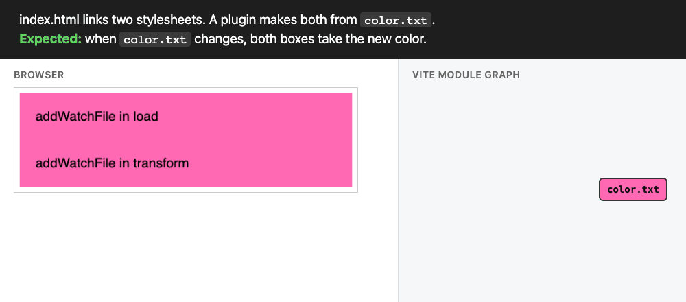

# Vite: `addWatchFile` in `load` is lost on a module's first request



`index.html` links the stylesheet `/color.css`. A plugin in `vite.config.js` makes it from `color.txt`, a file with one color, and calls `this.addWatchFile("color.txt")` in `load`. When `color.txt` changes, the box should take the new color. It keeps the old one.

## What happens

1. The browser requests `/color.css`. Its `load` hook calls `addWatchFile(color.txt)`. The module node for `/color.css` does not exist yet, so Vite drops the file.
2. Vite creates the node for `/color.css` after `load`. The node does not depend on `color.txt`.
3. `color.txt` changes from hotpink to lightblue. No module depends on it, so Vite sends no update.

## Try it

```sh
npm install
npm run dev
```

Open http://localhost:5173, change `color.txt` from `hotpink` to `lightblue` and save.

## Why

Vite keeps the files that `load` watches per module node, and drops them when the node does not exist yet ([pluginContainer.ts](https://github.com/vitejs/vite/blob/v8.3.5/packages/vite/src/node/server/pluginContainer.ts#L211-L219)):

```ts
const module = this.moduleGraph?.getModuleById(id)
if (module) {
  this._moduleNodeToLoadAddedImports.set(module, addedImports)
}
```

[`loadAndTransform`](https://github.com/vitejs/vite/blob/v8.3.5/packages/vite/src/node/server/transformRequest.ts#L269) calls `load` first and creates the node afterwards ([line 354](https://github.com/vitejs/vite/blob/v8.3.5/packages/vite/src/node/server/transformRequest.ts#L354)).

[@bluwy](https://github.com/bluwy) found the same cause in [vitejs/vite#18103](https://github.com/vitejs/vite/pull/18103), a PR with a failing test for this case:

> The `module` does not exist until the `load` hook finishes

He closed it with:

> Probably still an issue, but no one seems to have reported this so it's probably not important enough to fix this. Also, it's easier to track this in an issue.

A stylesheet that JS imports does not hit this: Vite creates its node while it analyzes the importer, before the browser requests the css. A stylesheet that only a `<link>` loads does, and SSR frameworks render such links in dev, Qwik for example.

Creating the node before `load` fixes the repro:

```diff
+ mod ??= await moduleGraph._ensureEntryFromUrl(url, undefined, resolved)
  const loadResult = await pluginContainer.load(id)
```

Calling `addWatchFile` in `transform` instead also works, because the node exists by then.
